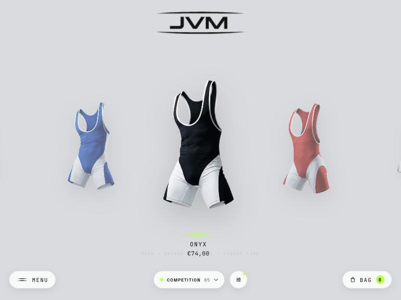

# JVM Shop Lines — Case Study

**E-Commerce-Erlebnis für ein Berliner Singlet-Label.**

---

Dieses Repo ist eine **Case Study ohne Quellcode**: Das Projekt läuft für einen laufenden Kunden auf Shopify, der Code bleibt privat. Hier zeige ich Aufgabe, Umsetzung und Ergebnis.

## Aufgabe

Statt eines austauschbaren Shopify-Standardthemes eine Shop-Seite, die sich wie eine eigene Produktwelt anfühlt: ein JS-gesteuertes One-Page-Erlebnis mit Coverflow-Carousel, Archiv-Ansicht und Warenkorb-Drawer — ohne Framework-Overhead.

## Umsetzung

- **Eigene Rendering-Engine:** ein handgeschriebenes JS-Modul steuert Carousel, Produktdetails (FLIP-Animation), Archiv-Grid und Warenkorb
- **Zwei Betriebsarten:** eine statische Vorschau mit Demo-Katalog für schnelle Design-Iteration, und ein Shopify-Theme, das dieselbe Engine an echte Shopify-Collections, Varianten und den AJAX-Warenkorb anbindet
- **Design-System:** Farben, Typografie, Radien, Schatten und Motion zentral in einem CSS-Token-File, darüber Komponentenklassen
- **Theme-Einstellungen:** alle Design-Stellschrauben als Shopify-Theme-Settings, damit das Team selbst anpassen kann

## Mein Teil

Konzept, UI/UX, komplette Frontend-Engine und Shopify-Theme-Integration.

## Tech-Stack

`JavaScript` `Shopify Liquid` `CSS` `Shopify AJAX Cart`

---

Gebaut von **Barkley Taylor** · [Studio Odiri](https://studio-odiri.com)
